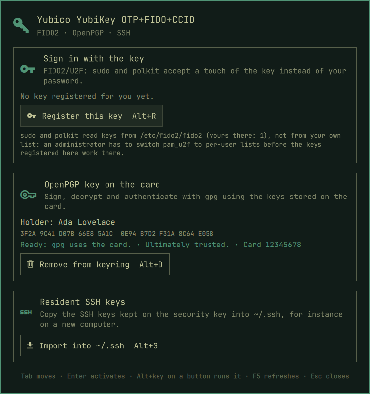

# security-key-omarchy

Set up a FIDO2 security key (a YubiKey, for instance) from an
[Omarchy](https://omarchy.org) shell overlay, instead of the terminal script
behind *Setup › Security › FIDO2*. Modelled on the security-key page of
[lbssousa/noctalia](https://github.com/lbssousa/noctalia/tree/feat/security-hardware)
and themed like the shell's polkit agent.



Three sections, each shown only when the key plugged in can do it:

- **Sign in with the key** (FIDO2/U2F): registers the key for sudo and
  polkit with `pamu2fcfg`, asking for its PIN when it has one, and lists the
  keys registered for you, each with its own remove button. Keys go to your
  own `~/.config/Yubico/u2f_keys` (pam_u2f's per-user default), so no sudo is
  needed.
- **OpenPGP key on the card** (keys with an OpenPGP applet): shows the
  holder, fingerprint and whether gpg knows the key; imports the public key
  from the URL stored on the card (or the keyservers), links it to the card
  and marks it as ultimately trusted. It also takes the key out of the
  keyring again (public key and card stubs; the key stays on the card), and
  refuses when gpg keeps a secret part of it on disk.
- **Resident SSH keys** (keys that keep discoverable credentials): copies
  them into `~/.ssh` with `ssh-keygen -K`, never over a file already there,
  and lists the ones in `~/.ssh`, each with its remove button (the key keeps
  them, so they can be imported again).

The key is noticed when it is plugged in or pulled out while the overlay is
open.

## Keyboard

| Key | Does |
|-----|------|
| Tab / Shift+Tab | Move between the buttons |
| Enter / Space | Activate the button; in the PIN dialog, run the action |
| Alt+R | Register the key (sudo and polkit) |
| Alt+1 … Alt+9 | Remove that item, counting the registered keys, then the SSH keys in `~/.ssh` (again, or Enter, confirms) |
| Alt+I | Import the OpenPGP public key / link it to the card |
| Alt+T | Trust the OpenPGP key ultimately |
| Alt+D | Remove the OpenPGP key from the keyring (again, or Enter, confirms) |
| Alt+S | Import the resident SSH keys |
| F5 | Look at the key again |
| Up / Down, Page Up / Page Down, Home / End | Scroll the card, when it is taller than the screen |
| Escape | Cancel what runs (a registration waiting for a touch), or close the PIN dialog or the overlay |

Each button shows its key. When the key has a PIN, registering and
importing the SSH keys ask for it in a dialog over the card, which then
waits for the touch; a wrong PIN keeps it open to try again.

In every language Omarchy offers under *Setup › Language*.

## How it works

The overlay is a shell plugin, `lbssousa.security-key` (`kind: overlay`).
While it's open it runs `key-helper`, a small Python program (standard
library only) that drives the same tools a terminal would: `fido2-token`,
`pamu2fcfg`, `gpg` and `ssh-keygen`, as you, without privileges. They speak
one JSON object per line over the helper's stdin and stdout; the protocol is
described at the top of `key-helper`.

PINs stay in the helper's memory for the one command that needs them and are
never logged or put in a command line or environment. `pamu2fcfg` reads the
PIN on its stdin; for `ssh-keygen -K` the helper is its own `SSH_ASKPASS`,
handing the PIN over a socket in a private folder of `$XDG_RUNTIME_DIR`.

### sudo and polkit

The overlay registers keys in your `~/.config/Yubico/u2f_keys`. sudo and
polkit read that file when their `pam_u2f.so` line has no `authfile=`
option. Omarchy's own `omarchy-setup-security-fido2` pins one shared file,
`/etc/fido2/fido2`, instead; the overlay then says so (and how many of your
keys that file holds), and an administrator has to switch the PAM lines to
per-user lists, for instance:

```
auth sufficient pam_u2f.so cue openasuser
```

The overlay doesn't change PAM itself. When neither sudo nor polkit asks for
a key yet, it points to `omarchy-setup-security-fido2`.

## Requirements

- Omarchy 4.5 (the Quattro shell).
- `libfido2` and `pam-u2f` (what *Setup › Security › FIDO2* installs),
  `gnupg` and `openssh`, all in Omarchy or installed by that setup.
- `python`, part of every Omarchy install.

## Install

```sh
omarchy plugin add https://github.com/lbssousa/security-key-omarchy.git --enable
```

Open it with:

```sh
omarchy-shell shell summon lbssousa.security-key '{}'
```

To have *Setup › Security › FIDO2* open it instead of the terminal script,
add to `~/.config/omarchy/extensions/omarchy-menu.jsonc`:

```jsonc
"setup.security.fido2": {"action":"omarchy-shell shell summon lbssousa.security-key '{}'"},
```

[omarchy-multiuser](https://github.com/lbssousa/omarchy-multiuser)'s menu
block does that already.

Update with `omarchy plugin update lbssousa.security-key`.

### As an Arch package

`packaging/` builds `security-key-omarchy`, which installs the plugin to
`/usr/share/security-key-omarchy/plugin` and an `omarchy-security-key`
command that opens it (or the terminal FIDO2 setup, when the plugin is off):

```sh
cd packaging && makepkg -si
ln -sfn /usr/share/security-key-omarchy/plugin ~/.config/omarchy/plugins/lbssousa.security-key
omarchy-shell shell rescanPlugins
omarchy-shell shell enablePlugin lbssousa.security-key '{}'
```

The running shell only looks for plugins when it starts or is asked to
rescan; until then `enablePlugin` answers `unknown`.

## Remove

```sh
omarchy plugin remove lbssousa.security-key
```

(`sudo pacman -R security-key-omarchy` and
`rm ~/.config/omarchy/plugins/lbssousa.security-key` for the package.) Drop
the `setup.security.fido2` line if you added it to the menu. Removing the
plugin leaves what it set up in place: the keys in
`~/.config/Yubico/u2f_keys` (remove them in the overlay first, or delete the
file), the OpenPGP key in your keyring and the SSH key files in `~/.ssh`.

## Development

```sh
just test      # node tests (model, catalogs), python tests (helper), lint, validation
just dev       # the overlay in its own Quickshell instance, on the real key
just dev ar    # ... in Arabic (right to left)
just link      # this checkout's plugin in the real shell
just pkg       # the Arch package
```

`just dev` runs `dev/shell.qml` from a temporary folder that links the
plugin's files and the shell's `Commons` and `Ui` from
`/usr/share/omarchy/shell`; the checkout itself carries no symlinks, which
`omarchy plugin add` refuses.

## License

MIT
