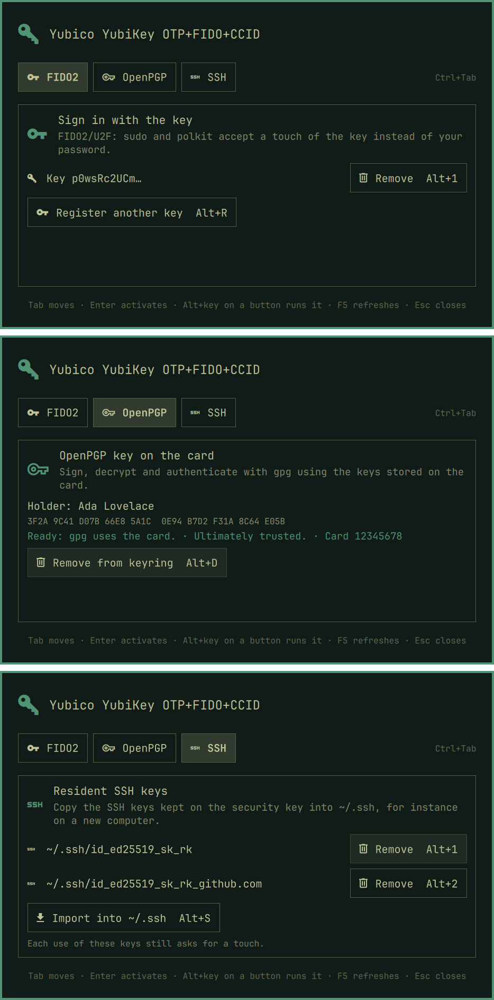

# security-key-omarchy

Set up a FIDO2 security key (a YubiKey, for instance) from an
[Omarchy](https://omarchy.org) shell overlay, instead of the terminal script
behind *Setup › Security › FIDO2*. Modelled on the security-key page of
[lbssousa/noctalia](https://github.com/lbssousa/noctalia/tree/feat/security-hardware)
and themed like the shell's polkit agent.



Three sections, each in its own tab (*FIDO2*, *OpenPGP*, *SSH*) and shown
only when the key plugged in can do it:

- **Sign in with the key** (FIDO2/U2F): registers the key for sudo and
  polkit with `pamu2fcfg`, asking for its PIN when it has one, and lists the
  keys registered for you, each with its own remove button. Keys go to your
  line of Omarchy's `/etc/fido2/fido2` through the package's helper, or to your
  own `~/.config/Yubico/u2f_keys` when PAM reads that file, and nowhere else
  (see below).
- **OpenPGP key on the card** (keys with an OpenPGP applet): shows the
  holder, fingerprint and whether gpg knows the key; imports the public key
  from the URL stored on the card (or the keyservers), links it to the card
  and marks it as ultimately trusted. Once gpg uses the card, the same button
  reads *Update key* and fetches the public key again (a new expiry date, new
  subkeys). It also takes the key out of the
  keyring again (public key and card stubs; the key stays on the card), and
  refuses when gpg keeps a secret part of it on disk.
- **Resident SSH keys** (keys that keep discoverable credentials): copies
  them into `~/.ssh` with `ssh-keygen -K`, never over a file already there,
  makes new ones (see [below](#resident-ssh-keys)), and lists the ones in
  `~/.ssh`, each in its own box: *Remove copy* (the key keeps it, so it can be
  imported again), *Delete from security key* (for good) and, when the key's
  application names a git host, *Use for &lt;host&gt;*.

The key is noticed when it is plugged in or pulled out while the overlay is
open.

## Keyboard

| Key | Does |
|-----|------|
| Tab / Shift+Tab | Move between the buttons |
| Ctrl+Tab / Ctrl+Shift+Tab, Ctrl+Page Down / Ctrl+Page Up | Next / previous tab |
| Left / Right, then Enter (on the tab bar) | Pick a tab |
| Enter / Space | Activate the button; in the PIN dialog, run the action |
| Alt+R | Register the key (sudo and polkit) |
| Alt+1 … Alt+9 | Remove that item of the tab shown: a registered key, or the copy of an SSH key in `~/.ssh` (again, or Enter, confirms) |
| Alt+I | Import the OpenPGP public key / link it to the card |
| Alt+T | Trust the OpenPGP key ultimately |
| Alt+D | Remove the OpenPGP key from the keyring (again, or Enter, confirms) |
| Alt+S | Import the resident SSH keys |
| Alt+N | Open the form for a new resident SSH key (Enter in a field creates it, Escape closes it) |
| F5 | Look at the key again |
| Up / Down, Page Up / Page Down, Home / End | Scroll the card, when it is taller than the screen |
| Escape | Cancel what runs (a registration waiting for a touch), or close the PIN dialog or the overlay |

Each button shows its key, and the Alt keys of the other tabs work too,
switching to their tab. When the key has a PIN, registering, importing and
making SSH keys ask for it in a dialog over the card, which then waits for the
touch; a wrong PIN keeps it open to try again. Deleting an SSH key from the
security key always asks for the PIN, after a second press of its button.

In every language Omarchy offers under *Setup › Language*.

## How it works

The overlay is a shell plugin, `lbssousa.security-key` (`kind: overlay`).
While it's open it runs `key-helper`, a small Python program (standard
library only) that drives the same tools a terminal would: `fido2-token`,
`pamu2fcfg`, `gpg` and `ssh-keygen`, as you, without privileges. They speak
one JSON object per line over the helper's stdin and stdout; the protocol is
described at the top of `key-helper`.

PINs stay in the helper's memory for the one command that needs them and are
never logged or put in a command line or environment. `pamu2fcfg` reads the
PIN on its stdin; for `ssh-keygen -K` the helper is its own `SSH_ASKPASS`,
handing the PIN over a socket in a private folder of `$XDG_RUNTIME_DIR`.

### sudo and polkit

The overlay only registers a key where sudo and polkit will read it, going by
their `pam_u2f.so` lines. It doesn't change PAM itself.

| sudo and polkit read keys from | Registering |
|--------------------------------|-------------|
| `/etc/fido2/fido2`, with the [Arch package](#as-an-arch-package) | Saves to your line there |
| `/etc/fido2/fido2`, without the package | Refused: says to install the package |
| `~/.config/Yubico/u2f_keys` (no `authfile=` option) | Saves there |
| Any other file | Refused: an administrator has to register the key |
| Different files | Refused: an administrator has to point them at the same file |
| Nothing yet (neither asks for a key) | Refused: points to `omarchy-setup-security-fido2` |

Omarchy's own `omarchy-setup-security-fido2` pins sudo and polkit to
`/etc/fido2/fido2`, which belongs to root. That script writes one registration,
but the file can hold several: the overlay runs `pkexec
omarchy-security-key-authfile add` (or `remove-key`, with the key's handle) and
the polkit agent asks you to authenticate. The helper only ever touches
`/etc/fido2/fido2`, and in it your own line, the one of the user pkexec names.
A plugin from the marketplace can't install that helper.

What sudo and polkit ask for when you use a key is up to their `pam_u2f.so`
line. To demand its PIN and a touch, add these options; the overlay then turns
away a key that has no PIN, which could never sign in:

```
auth sufficient pam_u2f.so cue authfile=/etc/fido2/fido2 pinverification=1 userpresence=1
```

Registering the key plugged in a second time is refused: the overlay asks it,
without a touch, whether it made one of your keys there.

Keys in `~/.config/Yubico/u2f_keys` that sudo and polkit no longer read, from
before they were pinned to another file, are listed as not used, each with its
remove button.

### Resident SSH keys

**A new key** is made on the security key with `ssh-keygen -O resident`, from
a form: the type (`ed25519-sk`, or `ecdsa-sk` for YubiKey firmware before
5.2.3), the application (what follows `ssh:`, such as `github.com`), a user
ID, a PIN and a touch for every use (both on by default) and a comment
(`user@host`). The user ID tells apart keys for the same application: a new
key with the same application and user ID replaces the old one on the
security key, so a random one is suggested. When the security key already
holds such a key, the PIN dialog says so and asks again before replacing it.
The application, user ID and comment are checked before the key is touched,
so the copy gets the name `ssh-keygen -K` would give it
(`id_<type>_rk_<application>_<user ID>`); the overlay shows the public key, to
copy to the server or git host.

**Deleting a key from the security key** can't be undone: it can't be
imported again, and every server that trusts it needs a new key. It takes two
presses of the button and the PIN, and only deletes the credential of that
very copy, found by the key handle in the copy's file (`fido2-token -L -k`,
then `fido2-token -D`). A copy of a key replaced since, or made on another
security key, deletes nothing. Copies with a passphrase are refused, since
their key handle can't be read.

**Git hosts.** For a key whose application names a git host
(`ssh:github.com`, `ssh:login@git.example.org:2222`: well-known forges, or
hosts with `git` in a name), *Use for &lt;host&gt;* writes
`~/.ssh/config.d/<host>.conf`, which has ssh use the keys for that host
without the agent:

```
Host github.com
    User git
    IdentityFile ~/.ssh/id_ed25519_sk_rk_github.com_…
    IdentitiesOnly yes
    IdentityAgent none
```

One file per host lists every key for it, and it adds `Include
config.d/*.conf` at the top of `~/.ssh/config` once, unless the file already
includes `config.d`. The overlay only ever changes the files it wrote
(their first line says so): one written by hand, or changed by hand since, is
left alone and the row says so. Removing a copy, or deleting its key, takes it
out of its host's file, and the file goes with its last key.

## Requirements

- Omarchy 4.5 (the Quattro shell).
- `libfido2` and `pam-u2f` (what *Setup › Security › FIDO2* installs),
  `gnupg` and `openssh`, all in Omarchy or installed by that setup.
- `python`, part of every Omarchy install.

## Install

```sh
omarchy plugin add https://github.com/lbssousa/security-key-omarchy.git --enable
```

Open it with:

```sh
omarchy-shell shell summon lbssousa.security-key '{}'
```

To have *Setup › Security › FIDO2* open it instead of the terminal script,
add to `~/.config/omarchy/extensions/omarchy-menu.jsonc`:

```jsonc
"setup.security.fido2": {"action":"omarchy-shell shell summon lbssousa.security-key '{}'"},
```

Update with `omarchy plugin update lbssousa.security-key`.

### As an Arch package

`packaging/` builds `security-key-omarchy`, which installs the plugin to
`/usr/share/security-key-omarchy/plugin`, an `omarchy-security-key` command
that opens it (or the terminal FIDO2 setup, when the plugin is off), and
`omarchy-security-key-authfile` with its polkit action, which save your keys in
`/etc/fido2/fido2`:

```sh
cd packaging && makepkg -si
ln -sfn /usr/share/security-key-omarchy/plugin ~/.config/omarchy/plugins/lbssousa.security-key
omarchy-shell shell rescanPlugins
omarchy-shell shell enablePlugin lbssousa.security-key '{}'
```

The running shell only looks for plugins when it starts or is asked to
rescan; until then `enablePlugin` answers `unknown`.

## Remove

```sh
omarchy plugin remove lbssousa.security-key
```

(`sudo pacman -R security-key-omarchy` and
`rm ~/.config/omarchy/plugins/lbssousa.security-key` for the package.) Drop
the `setup.security.fido2` line if you added it to the menu. Removing the
plugin leaves what it set up in place: the keys in
`~/.config/Yubico/u2f_keys` (remove them in the overlay first, or delete the
file), the OpenPGP key in your keyring, the SSH key files in `~/.ssh` and
the host files in `~/.ssh/config.d` with their `Include` line.

## Development

```sh
just test      # node tests (model, catalogs), python and shell tests (helpers), lint, validation
just dev       # the overlay in its own Quickshell instance, on the real key
just dev ar    # ... in Arabic (right to left)
just link      # this checkout's plugin in the real shell
just pkg       # the Arch package
```

`just dev` runs `dev/shell.qml` from a temporary folder that links the
plugin's files and the shell's `Commons` and `Ui` from
`/usr/share/omarchy/shell`; the checkout itself carries no symlinks, which
`omarchy plugin add` refuses.

## License

MIT
